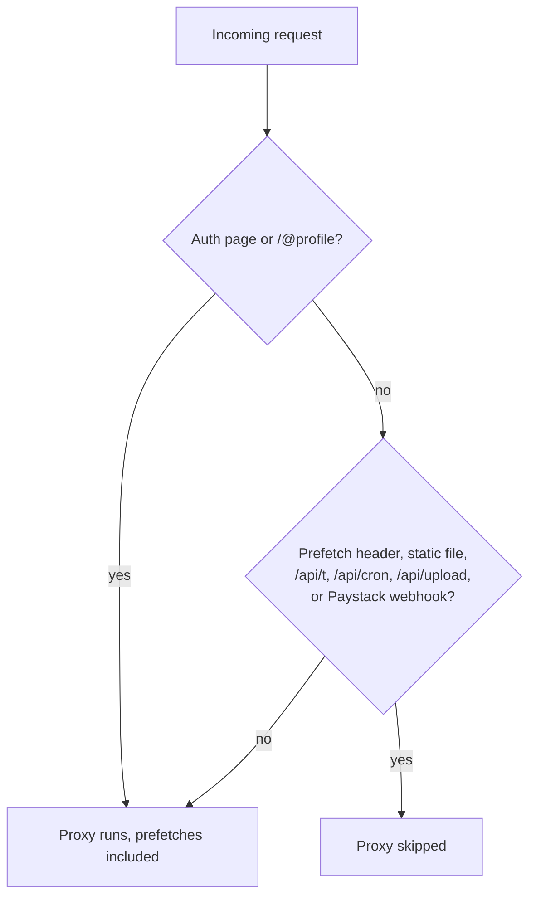

# 1 · Edge & routing

**Source of truth:** `src/proxy.ts`, `src/lib/supabase/proxy.ts`, `vercel.json`, `next.config.ts`
**Runs on:** Vercel

## Hosting

- Vercel project, framework `nextjs`, every function pinned to region **`dub1` (Dublin)** in `vercel.json`.
- Vercel's edge network serves static assets (`_next/static`, images, `public/`) and terminates TLS for `etivio.co`.

## Proxy (`src/proxy.ts`)

Next 16 renamed `middleware.ts` to `proxy.ts`. It runs before matching routes and does four things:

1. **Canonical host.** Redirects `www.etivio.co` to `etivio.co` with a 308, so search engines see one address.
2. **Profile URLs.** Rewrites `/@username` to the real route `/u/[username]`.
3. **Session and guards.** `updateSession()` refreshes the Supabase auth cookie and redirects signed-out visitors away from `/learn`, `/teach`, `/settings`, `/support`, `/profile` and `/admin` (except `/admin/login`). Requests with no `sb-…-auth-token` cookie skip the auth client entirely, which keeps bot and anonymous traffic cheap.
4. **Invites.** Any URL with `?ref=<code>` stores the code in the referral cookie, the same as visiting `/r/<code>`.

## Matcher

- These always run the proxy, even for prefetches: `/@…`, `/login`, `/signup`, `/welcome`, `/verify`, `/set-password`, `/admin/login`.
- Everything else skips link prefetches (`next-router-prefetch` or `purpose: prefetch` headers), static files, `robots.txt`, `sitemap.xml`, service workers, `/api/t`, `/api/cron`, `/api/upload` and `/api/paystack/webhook`. Skipping them cuts Vercel function invocations.

## Headers (`next.config.ts`)

- `/sw.js` and `/sw-push.js` are served with `Cache-Control: no-cache, no-store, must-revalidate` so browsers always pick up the old-PWA kill switch (see [12-pwa-analytics-seo.md](12-pwa-analytics-seo.md)).
