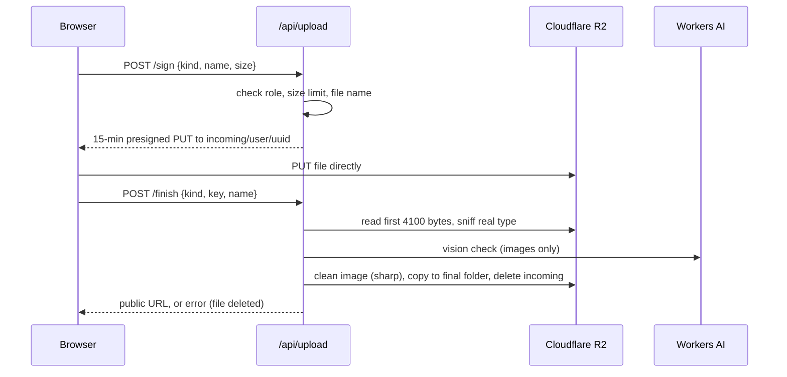

# 7 · File storage

**Source of truth:** `src/lib/r2.ts`, `src/lib/upload-server.ts`, `src/lib/upload-safety.ts`, `src/lib/upload-client.ts`, `src/app/api/upload/*`, `src/app/api/download/[fileId]`
**Service:** Cloudflare R2 (through the AWS S3 SDK)

Every uploaded file lives in a single R2 bucket. Uploads never pass through a Vercel function: the browser PUTs straight to R2 with a presigned URL, and the server inspects the file afterwards.

## Upload kinds

| Kind | Folder | Max size | Access |
|------|--------|----------|--------|
| cover | `covers/` | 10 MB | Public URL |
| avatar | `avatars/` | 5 MB | Public URL |
| post (Campus pictures) | `posts/` | 10 MB | Public URL |
| banner | `banners/` | 5 MB | Public URL |
| blog | `blog/` | 10 MB | Public URL |
| video | `videos/` | 2 GB | Public URL |
| document | `documents/` | 200 MB | Public URL |
| product (marketplace files) | `products/` | 500 MB | **Private.** Random unguessable key, served only through 5-minute signed links |

Allowed file types per kind live in `src/lib/upload-safety.ts`.

## Upload pipeline

Explicit images are blocked and earn the uploader a strike. Suggestive images are refused. See [10-ai-moderation.md](10-ai-moderation.md).

## Downloads

`GET /api/download/<fileId>` checks that the person bought the product (or made it, or is staff), logs the download, then redirects to a five-minute signed R2 URL.

## Video

A lesson video can be an R2 file or a YouTube, Vimeo or similar link (`src/lib/video.ts`). The learner player drives YouTube itself through `youtube-nocookie.com` instead of showing YouTube's own controls.
