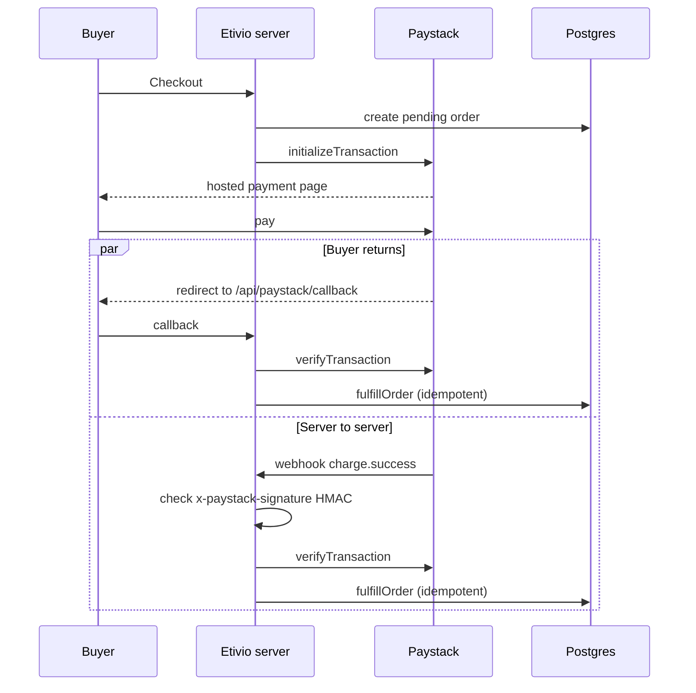

# 8 · Payments

**Source of truth:** `src/lib/paystack.ts`, `src/lib/data/checkout.ts`, `src/app/api/paystack/*`, `src/lib/payouts.ts`, `src/lib/banks.ts`, `src/lib/cart.ts`
**Service:** Paystack (`https://api.paystack.co`)

All money moves through Paystack's REST API with `PAYSTACK_SECRET_KEY`. `paystackReady()` reports whether the key is set.

## What goes through Paystack

- Course and product checkout, including guest checkout and carts
- Group buys
- Wallet top-ups (the wallet balance can also be spent at checkout)
- Coaching session bookings
- Saved cards, using Paystack authorization codes (`PaystackAuthorization`)
- Bank account resolution for tutor payouts and withdrawals
- Coupons and referral rewards, which change the amount before the Paystack charge

## Fulfilment

- An order can be fulfilled by either path, so `fulfillOrder` must stay safe to run twice.
- The webhook never trusts the payload's amounts. It always re-verifies with Paystack.
- Webhook URL to set in Paystack (Settings → API Keys & Webhooks): `https://etivio.co/api/paystack/webhook`.
- Abandoned checkouts get reminder emails from the `checkout-reminders` cron job (see [06-database.md](06-database.md)).
