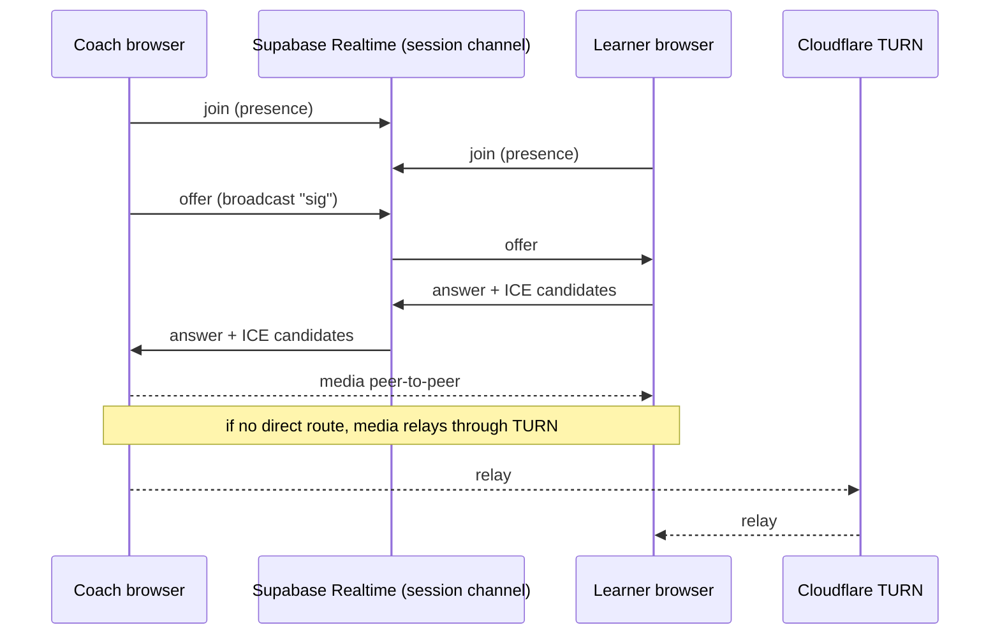

# 11 · Realtime & calls

**Source of truth:** `src/lib/supabase/realtime.ts`, `src/lib/ice.ts`, `src/components/coaching/CallRoom.tsx`, `src/components/chat/*`, `src/app/(call)`
**Services:** Supabase Realtime, Cloudflare Calls TURN

## Realtime channels

Browsers open channels with `listen()` from `src/lib/supabase/realtime.ts`. It attaches the person's access token (`realtime.setAuth`) **before** subscribing, because RLS filters database-change events and an anonymous channel would silently drop private rows.

| Channel | Used for |
|---------|----------|
| `inbox:<id>` | Messages and notifications |
| `campus-feed` | New Campus posts |
| `campus-online` | Who's online in Campus (presence) |
| `admin-support-threads` | Staff support inbox |
| `session:<id>` | Private broadcast and presence channel used as WebRTC signalling for a coaching call |

## Coaching calls

- Calls are peer-to-peer WebRTC (`RTCPeerConnection` in `CallRoom.tsx`).
- `iceServers()` in `src/lib/ice.ts` requests 24-hour ICE credentials from `rtc.live.cloudflare.com` when `CF_TURN_KEY_ID` and `CF_TURN_API_TOKEN` are set.
- Without them it falls back to `stun:stun.cloudflare.com:3478` only, which fails on many mobile networks.
- The `coaching` feature flag defaults to **off**.
