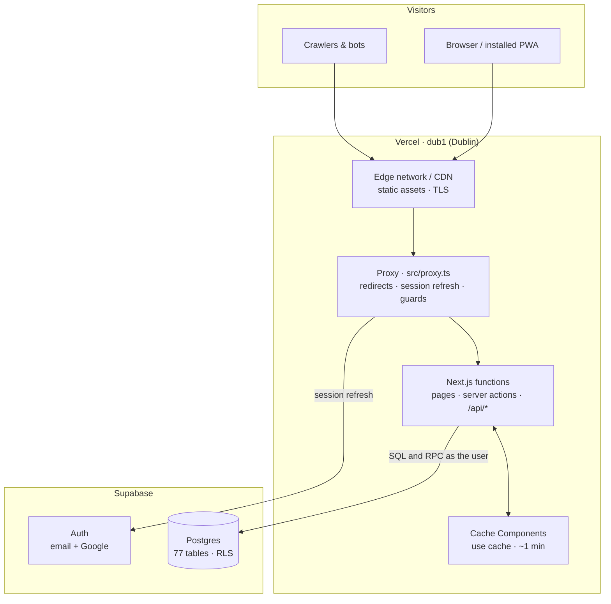
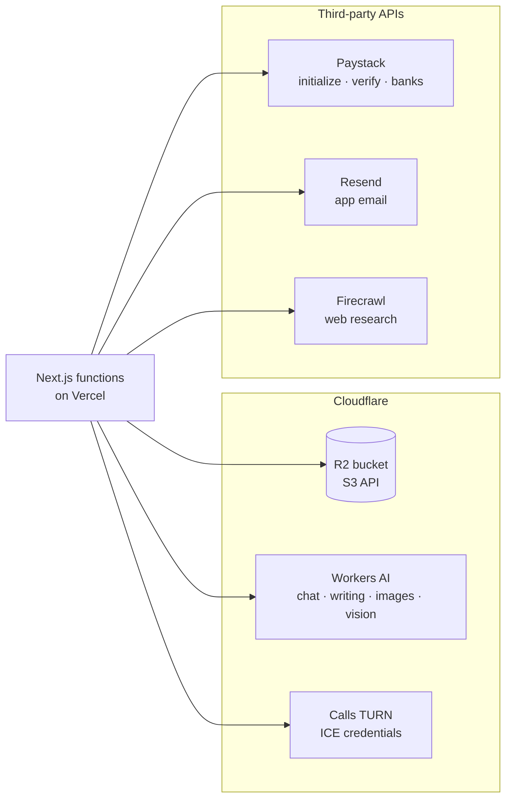
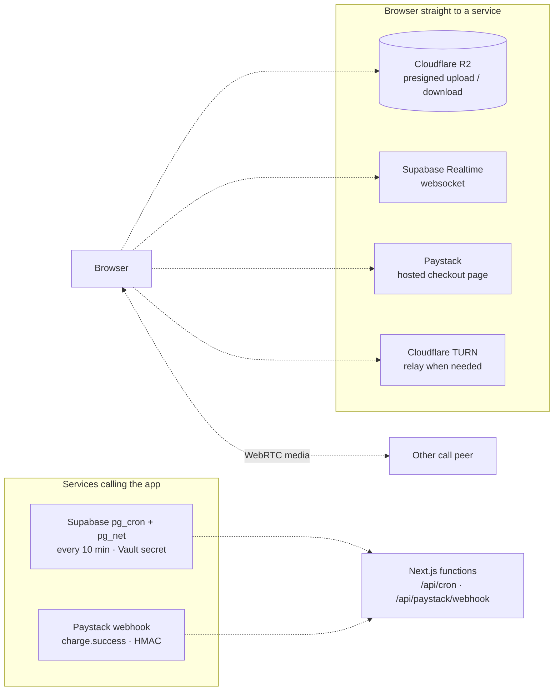
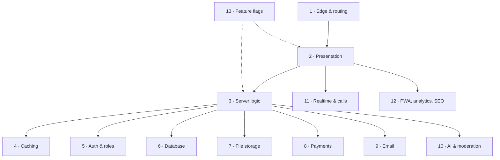

# Etivio architecture

How the Etivio learning marketplace is built and deployed: every layer from the browser to the database, the outside services it depends on, and how requests move between them.

- **Last verified against:** `test-optimize` @ `8f60503` (16 Nov 2026)
- **Stack:** Next.js 16.4.2 · React 19.3 · Supabase · Cloudflare R2 · Vercel (`dub1`)

## Keeping these docs current

These files describe the code as it is. **When you change code in a layer, update that layer's doc in the same piece of work.** The table below maps source paths to docs. If a change crosses layers, update every doc it touches. Then bump the "Last verified against" line here. The rule is also in `CLAUDE.md` and `AGENTS.md`.

| # | Layer | Doc | Source of truth |
|---|-------|-----|-----------------|
| 1 | Edge & routing | [01-edge-routing.md](01-edge-routing.md) | `src/proxy.ts`, `src/lib/supabase/proxy.ts`, `vercel.json`, `next.config.ts` |
| 2 | Presentation | [02-presentation.md](02-presentation.md) | `src/app/**/page.tsx`, `layout.tsx`, `src/components/`, `globals.css` |
| 3 | Server logic | [03-server-logic.md](03-server-logic.md) | `src/app/api/`, `**/actions.ts`, `src/lib/data/` |
| 4 | Caching | [04-caching.md](04-caching.md) | `"use cache"`, `cacheLife`, `cacheTag`, `updateTag` call sites, `next.config.ts` |
| 5 | Auth & roles | [05-auth-roles.md](05-auth-roles.md) | `src/lib/auth.ts`, `roles.ts`, `owner.ts`, `src/lib/supabase/`, `src/app/(auth)`, `src/app/auth` |
| 6 | Database | [06-database.md](06-database.md) | `supabase/migrations/`, `src/lib/database.types.ts`, `scripts/` |
| 7 | File storage | [07-file-storage.md](07-file-storage.md) | `src/lib/r2.ts`, `upload-*.ts`, `src/app/api/upload`, `src/app/api/download` |
| 8 | Payments | [08-payments.md](08-payments.md) | `src/lib/paystack.ts`, `src/lib/data/checkout.ts`, `src/app/api/paystack`, `payouts.ts`, `banks.ts` |
| 9 | Email | [09-email.md](09-email.md) | `src/lib/email/`, `supabase/templates/`, `scripts/configure-auth-email.mjs` |
| 10 | AI & moderation | [10-ai-moderation.md](10-ai-moderation.md) | `src/lib/ai.ts`, `ai-writer.ts`, `moderation.ts`, `src/app/api/ai` |
| 11 | Realtime & calls | [11-realtime-calls.md](11-realtime-calls.md) | `src/lib/supabase/realtime.ts`, `src/lib/ice.ts`, `src/components/coaching/CallRoom.tsx`, `src/components/chat` |
| 12 | PWA, analytics, SEO | [12-pwa-analytics-seo.md](12-pwa-analytics-seo.md) | `public/*.js`, `manifest.webmanifest`, `src/app/api/t`, `VisitTracker.tsx`, `robots.ts`, `sitemap.ts`, `seo.tsx` |
| 13 | Feature flags | [13-feature-flags.md](13-feature-flags.md) | `src/lib/features.ts`, `src/lib/data/features.ts` |
| — | Request flows | [request-flows.md](request-flows.md) | Any change to page load, upload, checkout or cron paths |
| — | Environments & config | [environments.md](environments.md) | `.env.example`, `package.json`, `vercel.json` |
| — | Risks | [risks.md](risks.md) | Review whenever any layer changes |

## At a glance

| | |
|---|---|
| Deployables | 1 Next.js app (monolith, no separate backend) |
| API route handlers | 15 |
| SQL migrations | 61 (`0001` → `0061`) |
| Tables | 77, all with RLS enabled |
| User roles | 9 |
| Feature flags | 11 |
| Outside services | Supabase, Cloudflare R2, Workers AI, Calls TURN, Paystack, Resend, Firecrawl |
| Scheduled jobs | 6 (pg_cron) |

## Production architecture

The production setup is split into three diagrams so each stays readable:

1. **Request path:** how a visit reaches the app and its data.
2. **Server-side calls:** what the app's server calls out to.
3. **Direct and inbound connections:** traffic that skips the app's server, and services that call into it.

### 1. Request path

### 2. Server-side calls

Every call here starts from a Vercel function (`src/lib/*`).

Supabase Auth also sends its own emails (sign-up, password reset) through Resend's SMTP server.

### 3. Direct and inbound connections

Dotted arrows skip the app's server.

## Layer map

