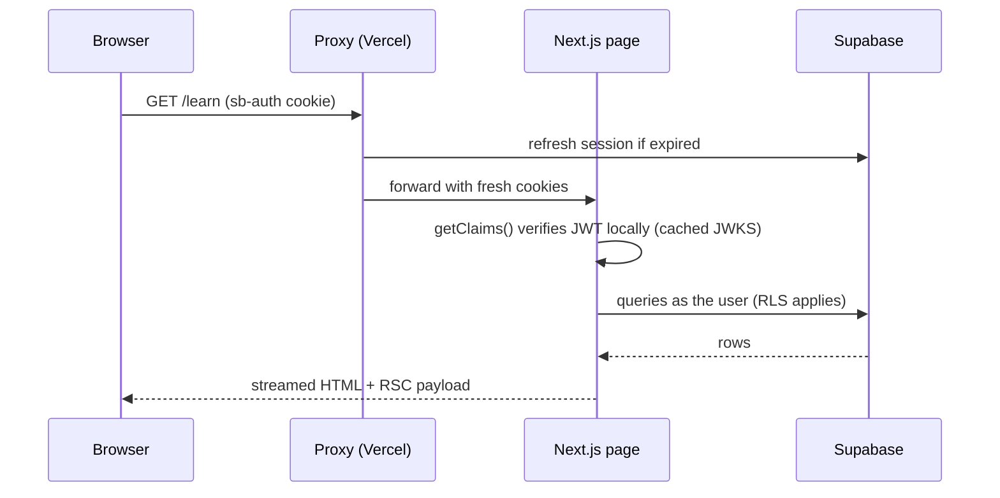
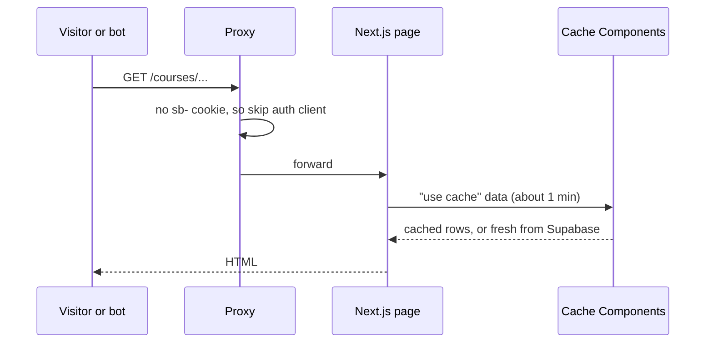
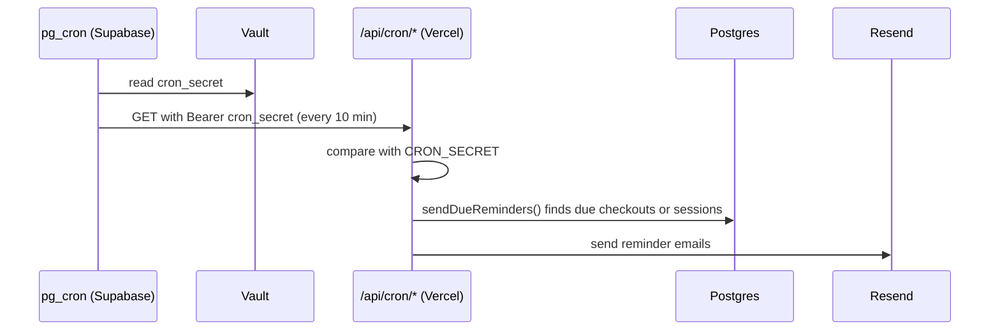

# Request flows

End-to-end paths that cross several layers. The upload, checkout and call flows are documented in their own layers:

- File upload: [07-file-storage.md](07-file-storage.md#upload-pipeline)
- Checkout and fulfilment: [08-payments.md](08-payments.md#fulfilment)
- Coaching call signalling: [11-realtime-calls.md](11-realtime-calls.md#coaching-calls)

## Signed-in page load

## Signed-out public page

## Scheduled reminders

